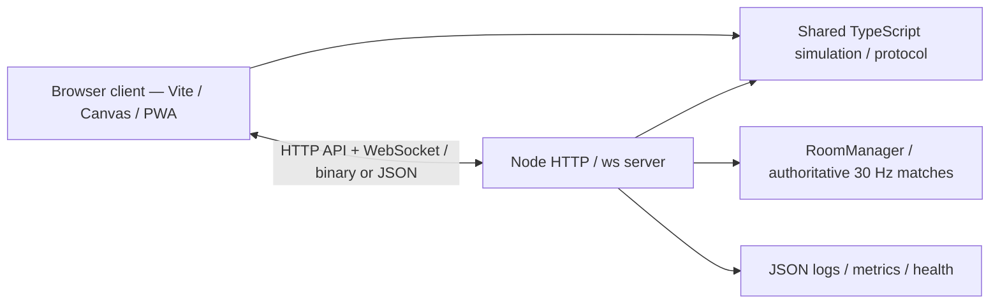
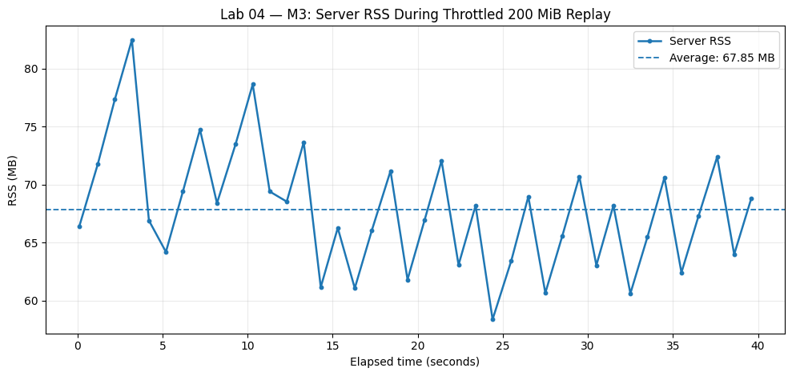

# Dogfight — Multiplayer Space Arena

A real-time multiplayer space shooter built with **TypeScript, HTML Canvas, WebSockets, Node.js and Vite**. Dogfight includes an authoritative server, deterministic shared physics, client-side prediction, interpolation, replay logging, diagnostics, and a production-oriented deployment setup.

**Release:** v1.0.0 (source prepared) · **Public game URL:** not published · **Demo GIF/video:** not recorded

## How to play

Choose a player name and room, then fly with **↑** (thrust), **← / →** (turn), and **Space** (fire). The server simulates collisions and damage. The lobby, roster and chat allow multiple players to share a match. A network panel can inject latency, jitter and loss for experiments. The local player uses prediction and reconciliation; remote entities are interpolated between snapshots.

## Architecture



The client and server share vector math, entities, deterministic simulation and Zod protocol definitions. Server-owned room state and players live in memory in **one running instance**. One instance avoids split-brain rooms; scaling later requires room-aware sticky routing or external room state (for example Redis pub/sub). Reverse proxies must support WebSocket Upgrade, `wss://` and idle timeouts longer than heartbeat intervals.

## Local development

```bash
npm install
npm run dev --workspace=server
npm run dev --workspace=client
```

The server defaults to port **3000** and the Vite client to **5173**. The browser WebSocket connection automatically selects `ws://` or `wss://` according to the page's protocol.

## Verification and measurements

| Verification | Measured result |
| --- | --- |
| Unit/property tests (Lab 07, Windows) | 126 passed / 126 |
| V8 coverage — statements / lines | 99.70% / 99.70% |
| V8 coverage — functions / branches | 98.88% / 91.90% |
| Playwright, two players (Lab 07, Windows) | 1 passed / 1 |
| Deterministic Node hash (1,000 steps) | `04d96aea` |

### Protocol benchmark (synthetic, four ships at 30 Hz)

| Wire format | Bytes per snapshot | Downlink per client | Encode + decode |
| --- | ---: | ---: | ---: |
| JSON | 667 | 19.54 KiB/s | 5.32 µs |
| Binary / `DataView` | 310 | 9.08 KiB/s | 6.12 µs |

These figures were measured for Lab 05 on Node 22.16.0 and represent a controlled benchmark, not live Internet traffic. Binary was smaller, but JSON was slightly faster in that specific encode/decode measurement.

### GC-oriented simulation microbenchmark (Lab 07, Node 22.16.0)

| Ship update implementation | Median | p95 | p99 |
| --- | ---: | ---: | ---: |
| Allocating vectors | 17.61 ms | 18.64 ms | 19.12 ms |
| Reusing vectors | 14.94 ms | 16.82 ms | 17.28 ms |

100,000 ship updates per run, after warm-up. **Load-test capacity and real-world RTT are not measured**; the 8/32/64/128-client runner does not establish capacity without accepted-connection counts and latency/tick metrics. No remote two-player demonstration or production uptime data is available.

## Laboratory implementation notes — Labs 01–08

## Lab 01 — JavaScript Fundamentals
### Overview
Explored the JavaScript event loop, `requestAnimationFrame`, fixed-timestep simulation, keyboard input and interpolated rendering.

### M2 — Ship Movement Tuning

The ship uses acceleration of `200`, rotation speed of `3` radians per second, drag of `0.99` per 60 Hz step (adjusted for `dt`), and a maximum speed of `300`. Acceleration increases velocity in the ship’s facing direction, drag gradually slows it down, and the speed cap prevents unlimited acceleration. These settings balance responsiveness and controllability. The exact sequence of tuning changes was not recorded.

### M4 — Experiments
#### Experiment 1 — Blocking the Main Thread
**Setup:** Added a synchronous busy-wait of 100 ms every 60 frames inside the render function.

**Observations:**

- The game visibly freezes during the blocking operation.

- Rendering is interrupted while JavaScript is busy.

- Frame duration increases significantly after the block.

- FPS temporarily decreases.

**Conclusion:**

JavaScript executes synchronously on the main thread. While a function is running, other JavaScript tasks and rendering callbacks cannot execute on that thread. Therefore, a 100 ms synchronous operation cannot be worked around by another JavaScript callback running on the same thread.

#### Experiment 2 — requestAnimationFrame vs setInterval
**Using setInterval (16 ms):**

- FPS: approximately 62–63.

- Frame duration: 15–17 ms.

- In background tab: FPS dropped to 1, then gradually returned to 30 and 62.

- Observation: setInterval is not synchronized with the monitor refresh rate and is throttled when the tab is in the background.

#### Experiment 3 — Fixed vs. Variable Timestep Under CPU Throttling

**Setup:** Compared the original fixed 60 Hz accumulator loop against a temporary variable-timestep loop calling `simulate(dt)` once per frame. The ship's thrust input was automated, and its X position was logged after approximately 5 real seconds using `performance.now()`. Each run started with the ship at `(400, 250)`. Chrome DevTools Performance CPU throttling was set to either `No throttling` or `6× slowdown`.

**Measured results:**

| Simulation | Normal CPU: X | CPU 6×: X | Absolute difference |
|---|---:|---:|---:|
| Fixed timestep | 731.29 | 736.29 | 5.00 px |
| Variable timestep | 727.47 | 735.58 | 8.11 px |

**Conclusion:** The fixed-timestep run showed a smaller difference between CPU settings in this measurement. Both methods produced similar final positions, so these results do not establish a large degradation of variable timestep under 6× throttling. The original fixed-timestep loop was restored after the experiment.

## Lab 02 — Objects, Prototypes & Classes
### M1 — Vector2 and Entity
#### Vector2
Implemented a `Vector2` class with pure methods returning new vectors without mutating the original instance:

- `add()`, `sub()` and `scale()`.

- `length()` and `normalize()`.

- `rotate()` and `dot()`.

- `static fromAngle()`.

#### Entity and Inheritance
- Created a base `Entity` class with `id`, `pos`, `vel`, `angle`, `radius`, `alive` and `kind`.

- Implemented a private static ID counter.

- Added `update(dt)` to update entity position using velocity.

- Refactored `Ship` to extend `Entity`, using a single inheritance level.

### M2 — The World
#### Entity Management
- Implemented a `World` class using a `Map` to manage entities.

- Added `spawn(e)`, `despawn(id)`, `get(id)`, `[Symbol.iterator]` and `ofKind(kind)`.

- Implemented `World.step(dt, inputs)` to update entities, resolve collisions and remove dead entities.

- Used deferred removal: entities are marked as dead and removed during the sweep phase.

#### Bullets and Asteroids
- Added `Bullet` with a time-to-live (TTL).

- Added `Asteroid` with drifting and bouncing movement.

- Implemented collision detection between bullets and asteroids.

- Implemented `Ship.fire()` to spawn bullets from the ship's nose with inherited velocity.

#### The `this` Binding Problem
JavaScript methods depend on how they are called. When passing an object method directly as an event handler, the method loses its original object context.

**Incorrect approach:**

```javascript

window.addEventListener('keydown', ship.fire);

```

In this case, `this` inside `fire()` does not refer to the `ship` instance. This can cause errors when the method tries to access properties such as `this.pos`, `this.vel` or `this.angle`.

**Correct approach using an arrow function:**

```javascript

window.addEventListener('keydown', () => ship.fire(world));

```

The arrow function calls `fire()` through the `ship` instance, preserving the correct `this` context.

In this project, the input system uses `justPressed()` and calls `ship.fire(world)` directly inside the simulation loop, avoiding the binding problem.

### M3 — Collisions, Damage & Respawn
#### Collision System
- Created a separate collision detection system in `sim/collision.js`.

- Implemented circle-circle collision detection.

- Used a naive O(n²) collision detection approach, keeping it separate from collision resolution for future optimization.

#### Damage and Health
- Added private HP fields with public getters to `Ship` and `Asteroid`.

- Implemented `takeDamage()` to handle damage and entity destruction.

- Added a 1-second damage cooldown to prevent continuous damage during collisions.

- Bullets deal damage to ships and asteroids.

#### Explosions and Respawn
- Created an `Explosion` entity with multiple short-lived particles.

- Added particle rendering with fading transparency.

- Implemented ship respawn after 2 seconds at a random safe position, away from asteroids.

#### Score
- Added a score system to `World`.

- Awarded 10 points for each destroyed asteroid.

- Displayed the score in the HUD.

### M4 — Composition vs. Inheritance
This milestone demonstrates how composition allows behavior to be reused without creating a complex inheritance hierarchy.

#### Homing behavior
Homing is implemented as a separate behavior in `sim/behaviors/homing.js`. Any entity can receive a `homing` configuration containing a target ID and turn rate. The `World` applies this behavior during each update.

This allows both bullets and asteroids to use homing without requiring specialized subclasses.

#### Pickups
Pickups are implemented as independent `Entity` objects. They have their own type and collision behavior, while the ship handles the effects through `applyPickup()`.

Two pickup types were implemented:

- **Shield:** prevents damage for 5 seconds.

- **Rapid Fire:** reduces the shooting cooldown for 5 seconds.

#### Design comparison
With inheritance, each behavior could require additional subclasses, such as `HomingAsteroid`, `HomingBullet`, or specialized pickup classes. This can lead to a rigid and increasingly complex class hierarchy.

Composition keeps behaviors independent and allows them to be attached to different entities. This makes the system more flexible, reusable, and easier to extend.

## Lab 03 — Asynchronous JavaScript
### M1 — Asset Pipeline and Loading Screen
#### Asset Manifest
Created `src/assets/manifest.json` to define the game's sprites, sounds and arena configuration.

#### Asset Loader
Implemented `src/assets/loader.js` with the following functions:

- `fetchJson()` checks the HTTP response status and throws an error when the request fails.

- `loadJson()` loads JSON resources.

- `loadImage()` loads images with `new Image()` and handles load, error and abort events.

- `loadAudio()` fetches audio files and decodes them using Web Audio.

- `withRetry()` retries transient failures using exponential backoff and jitter, without retrying HTTP 4xx errors.

- `loadAll()` loads all manifest resources concurrently using `Promise.all()`.

All loading functions support `AbortSignal` where applicable.

#### Loading Screen
- Added a loading screen rendered directly on the Canvas.

- Implemented a progress bar based on completed assets.

- The game starts only after `loadAll()` completes successfully.

- Added a cancellation button using `AbortController`.

- Added a retry button for failed or cancelled loading attempts.

- Aborted pending requests when loading fails or is cancelled.

#### Tests and Results
**Concurrent loading**

Tested `loadAll()` with three simulated resources, each taking approximately 200 ms.

- Maximum simultaneous requests: 3.

- All three resources completed successfully.

- Progress callbacks reported 0%, 33%, 67% and 100%.

**Retry and error handling**

- Simulated temporary HTTP 500 failures.

- Confirmed that the loader retries and succeeds on the third attempt.

- Confirmed that HTTP 404 errors are not retried.

- Verified that failed loading displays the retry button.

**Cancellation**

- Tested cancellation using `AbortController`.

- Confirmed that the request rejects with `AbortError`.

- Tested cancellation through the loading screen.

- Confirmed that the game does not start after cancellation and that the retry option appears.

**Sequential vs. concurrent execution**

Compared three simulated asynchronous operations, each taking approximately 200 ms.

| Execution method | Measured time |
|---|---:|
| Sequential (`fetchJson`) | 623 ms |
| Concurrent (`Promise.all`) | 212 ms |

The test used three independent JSON requests with an artificial 200 ms delay per request. Concurrent execution completed approximately 2.9 times faster than sequential execution.

**Conclusion**

`Promise.all()` allows independent asynchronous operations to run concurrently instead of waiting for each operation to finish before starting the next one. The asset loader uses this approach to reduce total loading time while reporting progress and handling failures.

### M2 — Sprites, Sound, and Events

Ships, bullets, and asteroids render using the loaded sprite sheet. The `audio.js` module manages `AudioContext`, plays decoded buffers for shooting, hits, and explosions, and unlocks audio after a click or key press during gameplay. The simulation emits `fired`, `hit`, and `exploded` events; the audio module subscribes without being imported by the simulation. `hud.js` listens for score updates.

### M3 — Lobby over HTTP

The lobby fetches the room list from `/api/rooms.json`, lets the player enter a name and select a room, then starts the local game using the selected room's arena. `Lobby extends EventTarget`, while `lobby-ui.js` handles the DOM. The lobby refreshes every 5 seconds, uses `AbortSignal.timeout(5000)` for each room request, and aborts pending requests on leaving. Joining a room was tested successfully.

### M4 — Failure Gallery

| Failure | Test and observed result | Recovery |
|---|---|---|
| Missing sprite (HTTP 404) | Changed a sprite path to a nonexistent file. The loading screen displayed `Falha ao carregar os recursos. Tente novamente.` and the retry button. HTTP 404 is not retried by `withRetry()`. | Restored the path; the game loaded normally. |
| Network timeout (simulated) | A simulated `TimeoutError: Network timeout` caused `withRetry()` to make 3 attempts before rejecting. A separate temporary `TimeoutError` thrown at the start of `loadAll()` displayed the loading error and retry button. | Removed the temporary throw; the game loaded normally. |
| Abort mid-load | Under Slow 3G, clicked `Cancelar carregamento`. The screen displayed `Carregamento cancelado.` and the retry button. | Restored No throttling and clicked `Tentar novamente`; the game loaded without refreshing the page. |
| Corrupt JSON | Temporarily added a trailing comma to `arena.json`. JSON parsing failed and the loading screen displayed the error message. A separate invalid-JSON test returned `SyntaxError`. | Restored valid JSON; the game loaded normally. |

The timeout tests used simulated exceptions, **not a real stalled network request**. The asset loader retries thrown timeout errors but does not impose its own request deadline; the 5-second timeout in `lobby.js` applies to room-list requests.

### M4 — Microtasks and Tasks
This milestone explores JavaScript's event loop and the execution order of synchronous code, microtasks and tasks.

#### Challenge 1 — Synchronous Code, Promises and queueMicrotask
**Code:**

```javascript

console.log('A')

setTimeout(() => {

    console.log('B')

}, 0)

Promise.resolve().then(() => {

    console.log('C')

})

queueMicrotask(() => {

    console.log('D')

})

console.log('E')

```

**Observed output:**

```text

A → E → C → D → B

```

**Explanation:**

- A and E execute synchronously.

- C and D are microtasks.

- B is a task scheduled by setTimeout.

- Microtasks execute before the next task.

#### Challenge 2 — Nested Promises and setTimeout
**Code:**

```javascript

console.log('A')

Promise.resolve().then(() => {

    console.log('B')

    setTimeout(() => {

        console.log('C')

    }, 0)

    Promise.resolve().then(() => {

        console.log('D')

    })

})

setTimeout(() => {

    console.log('E')

}, 0)

console.log('F')

```

**Observed output:**

```text

A → F → B → D → E → C

```

**Explanation:**

- A and F execute synchronously.

- B executes as a Promise microtask.

- During B, two callbacks are scheduled: C as a task and D as a microtask.

- D executes before the next task.

- E executes before C because its timer was scheduled first.

#### Challenge 3 — async/await
**Code:**

```javascript

async function teste() {

    console.log('B')

    await Promise.resolve()

    console.log('D')

}

console.log('A')

teste()

console.log('C')

setTimeout(() => {

    console.log('E')

}, 0)

```

**Observed output:**

```text

A → B → C → D → E

```

**Explanation:**

- A executes synchronously.

- B executes immediately when the async function is called.

- C executes before the async function resumes.

- D executes as a microtask after the await.

- E executes as a task scheduled by setTimeout.

#### Challenge 4 — requestAnimationFrame and Promises
**Code:**

```javascript

console.log('A')

requestAnimationFrame(() => {

    console.log('B')

    Promise.resolve().then(() => {

        console.log('C')

    })

})

setTimeout(() => {

    console.log('D')

}, 0)

Promise.resolve().then(() => {

    console.log('E')

})

console.log('F')

```

**Observed output:**

```text

A → F → E → D → B → C

```

**Explanation:**

- A and F execute synchronously.

- E executes as a microtask.

- D executes through setTimeout.

- B executes during a requestAnimationFrame callback before a browser repaint.

- C executes as a microtask created inside the animation frame callback.

The relative order of requestAnimationFrame and setTimeout callbacks can vary depending on browser scheduling. The sequence above is the one observed during this experiment.

#### Challenge 5 — Combined Async Execution
**Code:**

```javascript

console.log('A')

setTimeout(() => {

    console.log('B')

    Promise.resolve().then(() => {

        console.log('C')

    })

}, 0)

Promise.resolve().then(async () => {

    console.log('D')

    await null

    console.log('E')

})

queueMicrotask(() => {

    console.log('F')

})

console.log('G')

```

**Observed output:**

```text

A → G → D → F → E → B → C

```

**Explanation:**

- A and G execute synchronously.

- D executes as the first microtask.

- F executes as the next microtask.

- E executes when the async function resumes after await.

- B executes as a task scheduled by setTimeout.

- C executes as a microtask created inside the setTimeout callback.

#### Conclusion
These experiments demonstrate the difference between synchronous execution, microtasks and tasks.

Promises, async/await and queueMicrotask use the microtask queue, while setTimeout schedules tasks. requestAnimationFrame schedules callbacks associated with the browser's rendering cycle.

Understanding this execution order is important when working with asynchronous operations, animations and game loops.

## Lab 04 — Node.js, Streams and Server Hardening

### M3 — Streams and Backpressure

A synthetic 200 MiB NDJSON file was streamed through the replay endpoint using a download rate limit of 5 MiB/s.

The server's resident set size (RSS) was sampled approximately once per second during the transfer.

**Results:**

| Metric | Result |
|---|---:|
| File size | 200 MiB |
| Download rate limit | 5 MiB/s |
| Duration | ~40 seconds |
| RSS samples | 40 |
| Minimum RSS | 58.38 MB |
| Average RSS | 67.85 MB |
| Maximum RSS | 82.49 MB |

**Memory Usage Graph**



**Conclusion**

Memory usage fluctuated between 58.38 MB and 82.49 MB without sustained growth during the transfer.

The streaming implementation transferred the large file without loading it entirely into memory, demonstrating memory-efficient processing with Node.js streams and backpressure.

### M4 — Abuse Handling and the Event Loop

#### Abuse Handling

Implemented the following server protections:

- **Rate limiting:** Per-connection token bucket allowing 10 messages per second, with a burst capacity of 10. Connections exceeding the limit are closed.
- **Payload limit:** WebSocket messages are limited to 4 KiB using `maxPayload`.
- **Room limits:** Maximum of 8 players per room and 10 rooms per server.
- **Slow clients:** When `socket.bufferedAmount` exceeds 64 KiB, non-critical chat messages are dropped and critical updates trigger connection closure.

#### Node.js Event Loop

The Node.js event loop processes asynchronous operations through several phases:

1. **Timers:** Executes callbacks scheduled by `setTimeout()` and `setInterval()`.
2. **Pending callbacks:** Executes certain deferred I/O callbacks.
3. **Idle/prepare:** Internal Node.js operations.
4. **Poll:** Processes I/O events, including network activity.
5. **Check:** Executes `setImmediate()` callbacks.
6. **Close callbacks:** Handles events such as socket closure.

Microtasks, including Promise callbacks, are processed at appropriate checkpoints between JavaScript callbacks.

**Blocking experiment**

Implemented `/api/slow` with a deliberate synchronous busy-loop lasting 300 ms.

The endpoint returned:

```json
{"message":"Blocking operation completed","durationMs":300}
```

During a synchronous block, Node.js cannot process other JavaScript callbacks, including incoming WebSocket chat messages.

A temporary 30-second block made the delay clearly observable. The endpoint was then restored to the required 300 ms.

#### Backpressure

Backpressure occurs when data is produced faster than it can be consumed.

In M3, streams used `pipeline()` to manage data flow between the source, transformation, and destination.

A synthetic 200 MiB NDJSON file was downloaded with a rate limit of 5 MiB/s.

The server's RSS remained between 58.38 MB and 82.49 MB, without sustained growth during the approximately 40-second transfer.

This demonstrated memory-efficient streaming without buffering the entire file.

#### Unhandled Errors and Rejections

**Unhandled EventEmitter error**

Emitting an `"error"` event without a listener caused Node.js to throw an exception:

```text
node:events:505
    throw er; // Unhandled 'error' event

Error: boom
Emitted 'error' event at:
```

Adding an error listener prevented the crash:

```javascript
emitter.on('error', (error) => {
    console.error('Handled:', error.message);
});
```

Output:

```text
Handled: boom
```

**Unhandled Promise rejection**

An unhandled rejection, executed with `--unhandled-rejections=strict`, terminated the process:

```text
Error: Unhandled rejection demo
    at [eval]:1:16

Node.js v26.13.1
```

Handling the rejection with `.catch()` prevented the crash:

```javascript
Promise.reject(new Error('Rejection demo'))
    .catch((error) => {
        console.error('Handled:', error.message);
    });
```

Output:

```text
Handled: Rejection demo
```

These experiments demonstrate why EventEmitter error listeners and Promise rejection handlers are necessary for reliable Node.js servers.

## Technologies

JavaScript / TypeScript (strict), Node.js, Vite, npm workspaces, HTML5 Canvas, Web Audio API, WebSocket (`ws`), Zod, Node.js Streams, `DataView`, `ArrayBuffer`, Vitest, fast-check, Playwright, ESLint (type-checked), Prettier, Chrome DevTools, Web Workers, and GitHub Actions.

## Lab 05 — Real-Time Networking

**Run:** `npm install` at the repository root; in separate terminals run `npm run dev --workspace=server` and `npm run dev --workspace=client`. Open the Vite URL in two browser windows, and join the same room.

**Controls:** Arrow Up = thrust, Arrow Left/Right = turn, Space = fire.

The authoritative server runs a fixed 30 Hz `World.step()` per room, validates sequenced inputs, and sends snapshots containing the server tick, last acknowledged input sequence, per-player IDs, a seeded PRNG value, and entity state. Both runtimes use the pure `shared/` workspace. A seeded `mulberry32` replaces gameplay randomness. The Node test imports the simulation without DOM and produces a repeatable 1,000-step hash; verify the same hash in the browser by calling `import('/src/determinism-check.ts').then(m => console.log(m.determinismHash()))` in DevTools.

### Netcode: latency, consistency, and cheating

**Latency:** Without prediction, the local ship only moves when a snapshot arrives, making even 100 ms of one-way artificial delay noticeable. With prediction, inputs are immediately applied using the shared ship simulation, retained in a sequence-numbered buffer, and sent to the server. When a snapshot arrives, the client restores the authoritative state, discards acknowledged inputs, replays pending inputs, and smoothly blends visual corrections over approximately 100 ms. The netgraph reports RTT, snapshot age, pending inputs, correction magnitude, and outgoing/incoming traffic. Set Latency to `100`, Jitter to `0`, Drop to `0`, then compare **Client prediction** on versus off and record a screenshot showing the netgraph.

**Consistency:** Fixed time steps, reproducible inputs, and a seeded random generator reduce client/server drift. The **Break determinism** checkbox deliberately adds `Math.random()` to predicted movement for the M2 exercise. Observe growing corrections in the netgraph, capture the result, then turn the checkbox off; do not leave this experiment enabled during normal play. Real collisions still produce correction spikes because the client predicts only the local ship, not the whole collision world.

**Cheating:** The client submits only validated `{seq,tick,thrust,turn,fire}` inputs, not its own location. The server computes all authoritative positions and can reject malformed data or rate-limit excessive traffic. This prevents a client from teleporting by sending forged coordinates; a determined attacker could still abuse allowed inputs, so server limits remain necessary.

**Interpolation:** Other entities render from buffered snapshots with a live-adjustable delay (default 100 ms). A larger delay handles more jitter but shows older remote positions; a smaller delay reduces visible latency but increases stutter if a snapshot arrives late. Appearing and disappearing entities are handled at snapshot boundaries. The player's bullets are spawned immediately in a local predicted visual layer and are replaced when a matching authoritative bullet arrives.

**Latency demonstration:** Two browser windows, same room, configure `100 ms` latency, `30 ms` jitter, and `2%` drop. Record **20 seconds of both windows side-by-side** as a GIF, then put it at the very top of this README (for the rest of the course). The GIF must be captured on the user's running game, not generated from synthetic data.

### M4 — Binary (`DataView`) protocol

The versioned, little-endian wire layout is specified in the opening comment of `shared/codec/binary.ts`. Inputs use 16 bytes; snapshots contain a header, entity count, UTF-8 player IDs, entity records, events, and angles quantized to signed `Int16` milliradians (~0.001 rad resolution). The browser uses `socket.binaryType = 'arraybuffer'`. **Binary is the default**; add `?codec=json` to the game URL to compare with the original JSON protocol.

Run `npm run test:lab05` for the round-trip, deterministic-state, and runtime protocol tests. Run `npm run bench:lab05` for a synthetic **four-player, 30 Hz** comparison. The values below were measured by running the included benchmark script in this environment (Node.js 22.16.0, 20,000 encode/decode iterations per codec). This is a synthetic four-ship payload, not real-match traffic; timing varies by machine.

| Codec | Bytes/snapshot | KiB/s per client (down) | KiB/s per client (up) | Encode+decode µs |
| --- | ---: | ---: | ---: | ---: |
| JSON | 667 | 19.54 | 2.34 | 5.32 |
| Binary (`DataView`) | 310 | 9.08 | 0.47 | 6.12 |

The reduced bytes/s are the benefit in this sample, even though binary encode+decode was slightly slower on this CPU. Results vary by machine and entity contents.

### Verification results (executed here)

The included `npm run test:lab05` passed **3 of 3** tests:

- Binary input encode/decode round-trip.
- Binary snapshot encode/decode round-trip within quantization tolerance.
- Pure shared simulation import in Node and repeatable 1,000-step deterministic state hash: `04d96aea`.

The deterministic hash was verified by repeated Node executions **only**. A Chrome-to-Node comparison was not run, so cross-runtime determinism is not yet confirmed.

For a four-ship synthetic snapshot at 30 Hz, binary encoding used **310 bytes** versus **667 bytes** for JSON (approximately **53.5% fewer bytes**). The JSON codec was faster in this particular encode/decode benchmark; the binary codec reduced estimated bandwidth.


## Lab 06 — TypeScript: Types for Both Sides of the Wire

Migrated the `client`, `server`, and `shared` workspaces from JavaScript to TypeScript. The canvas renderer, lobby, multiplayer gameplay and server simulation continue to use the existing application architecture. **No UI framework was added:** React/Svelte/Vue were optional, and the vanilla lobby/HUD already work without extra runtime dependencies or bundle size.

### Toolchain and run commands

```bash
npm install
npm run typecheck
npm run test:lab06
npm run build
npm run dev --workspace=server
npm run dev --workspace=client  # separate terminal
```

The root `tsconfig.base.json` enforces `strict`, `noUncheckedIndexedAccess`, and `verbatimModuleSyntax`. Every workspace has its own `tsconfig.json`. The server runs through `tsx` (Node.js TypeScript type stripping is also suitable for erasable syntax); Vite transpiles the client, while `tsc` checks types independently. `.github/workflows/typecheck.yml` installs dependencies and runs the same typecheck/tests in CI. `server/.env.example` documents optional configuration; real `.env` files remain ignored.

### What TypeScript found

These are concrete incompatibilities surfaced during the migration and fixed in the code:

1. **Nullable Canvas and DOM elements:** `getContext('2d')` and `querySelector()` can return `null`. The renderer now checks those results before using them instead of assuming they exist.
2. **Unchecked collection/snapshot lookups:** `Map.get()`, `history[i]` and `find()` can return `undefined`. The world and netcode now guard missing entries before reading their properties.
3. **Mutation of a readonly vector:** the local prediction experiment modified `ship.pos.x` directly. It now replaces `ship.pos` with a new `Vector2`, preserving the `readonly x/y` contract.
4. **Untrusted network JSON:** the previous code accessed results of `JSON.parse()` directly. Messages now enter as `unknown`, then pass through Zod `safeParse` and a `Result`-style parser before entering the game logic.
5. **Unbranded snapshot identities:** raw numeric entity IDs cannot be assigned straight to `EntityId`. `fromSnapshot()` validates them with `entityId()`, catching accidental mixing of unrelated numeric values.

### Three particularly useful types

**1. `ClientMessage` inferred from a Zod discriminated union:** `type` selects the exact permitted fields for `join`, `chat`, `input`, `ping`, and `networkConfig`. For example, an input has a three-value `turn` (`-1 | 0 | 1`). The compiler narrows handlers by `type`; the schema also checks real messages at runtime, where TypeScript itself has no effect.

**2. `EntitySnapshot` plus branded numbers:** each snapshot has a literal `kind` (`ship`, `bullet`, `asteroid`, `pickup`, or `explosion`) and only the properties that apply to that kind. The exhaustive `never` case makes an unhandled entity kind a compile error. Branded `EntityId`, `Tick`, and `Seq` types prevent swapping unrelated numeric concepts while remaining numbers at runtime. `Vector2` and snapshot fields are `readonly` at compile time.

**3. `Bus<GameEvents>`:** generic `on<K extends keyof Events>()`/`emit()` methods connect an event name to its expected payload. `scoreChanged` requires a number; `fired` requires `null`. That relationship replaces scattered, loosely typed browser event payloads without introducing a framework.

### Binary codec and validation

`shared/codec/index.ts` defines a `Codec<T>` interface and JSON/binary implementations. The binary decoder checks the version byte, truncated lengths, numeric finiteness, input turn/flag ranges, and entity/event kinds. Its result is a typed `Snapshot`; the JSON variant goes through a Zod-backed boundary. The server's hand-written Lab 04 message validator was removed in favor of `shared/protocol.ts`.

**Type assertions:** the only three `as` casts in application source are the `EntityId`, `Tick`, and `Seq` constructors, which attach brands *after* validating numbers. No `any` is used in application TypeScript.

### Automated checks and benchmark

The project includes TypeScript type-checking, codec and determinism tests, protocol validation tests, and a GitHub Actions workflow that runs checks on each push and pull request.

The existing three codec/determinism regression tests passed in Node.js 22.16.0, including the deterministic state hash `04d96aea`.

A synthetic snapshot benchmark measured JSON at 680 bytes and binary at 310 bytes, equivalent to approximately 19.92 KiB/s versus 9.08 KiB/s per client at 30 Hz. These figures describe the synthetic benchmark rather than live match traffic.

## Lab 07 — Engine Performance and Testing

[](https://github.com/BorysenkoVeronika/dogfight/actions/workflows/ci.yml)

### Testing and CI

- Root `npm test` executes Vitest with V8 coverage thresholds configured for shared modules (85% minimum).
- Vector operations, fixed-step ship movement, collisions, deterministic simulation, pure reconciliation, token-bucket rate limiting, accumulator loop and heartbeat have focused unit tests.
- Five fast-check properties exercise the binary codec, packet length, malformed buffers, bounded arena movement, and parser acceptance/rejection.
- Playwright opens two Chromium contexts and checks room roster, cross-client movement and chat.
- GitHub Actions runs typecheck, type-checked ESLint, unit tests/coverage, build, and Chromium E2E.

### Profiling methodology

The client uses `performance.mark/measure` spans for `simulate`, `render`, `decode` and `reconcile`. In a running game, `window.dogfightProfile.frameReport()` returns p50/p95/p99 from frame samples; `window.dogfightProfile.downloadFrameSamples()` exports a CSV. Chrome Performance and Memory traces provide GC pauses, allocator rankings and flame-chart screenshots. The server's `/api/stats` also includes tick p99, RSS bytes and event-loop utilization.

### V8 shape microbenchmark (Node.js 22.16.0, Linux)

100 runs after warm-up; milliseconds. These are synthetic benchmark results, not game frame times.

| Access pattern | Median | p95 | p99 |
|---|---:|---:|---:|
| Same object shape | 0.756 | 0.975 | 1.074 |
| Mixed object shapes | 0.805 | 0.914 | 1.011 |
| Float32Array iteration | 0.965 | 1.109 | 2.142 |

A typed array did **not** win this particular iteration benchmark. The measurement does not justify changing all entity storage to typed arrays.

### Simulation hot path: in-place vectors

Measured 24 runs of 100,000 fixed-step ship updates following warm-up. Values in milliseconds; environment: Node.js 22.16.0, Linux.

| Implementation | Median | p95 | p99 |
|---|---:|---:|---:|
| Allocating Vector2 methods | 17.61 | 18.64 | 19.12 |
| Reusing vectors in hot paths (including swept collision state) | 14.94 | 16.82 | 17.28 |

The median improved, while tail latencies varied across runs; the table records the final implementation after adding swept bullet collision state. The deterministic simulation hash remained `04d96aea`. Pure `Vector2` methods are still available; explicit in-place methods are used in hot paths. Swept bullet collision checks cover targets crossed between ticks.

### Bots, worker and load measurement

- Server-side AI uses the same input format as a human; `POST /api/rooms/:id/bots` with `{ "count": N }` inserts up to the room capacity.
- `window.dogfightWorkerBenchmark()` compares NDJSON replay parsing in the browser main thread against a worker using a transferred ArrayBuffer; the worker is an experiment and is not enabled in the game loop by default.
- `npm run bench:load` ramps headless WebSocket clients at 8, 32, 64 and 128, collecting tick p99, event-loop utilization, RSS and inbound bytes/s in `load-results.csv`. Existing room/server caps can reject some connections; rejected clients must not be counted as server capacity.

### Development commands

```bash
npm install
npm run typecheck
npm run lint
npm test
npm run build
npm run test:e2e
npm run bench:engine
npm run bench:load
```

## Lab 08 — Production and launch

### M1 — Production-ready Node process

- Zod validates `PORT`, `HOST`, `NODE_ENV`, `LOG_LEVEL`, `ALLOWED_ORIGINS`, `MAX_CONNECTIONS_PER_IP`, `MAX_ROOMS` and `MAX_PLAYERS_PER_ROOM` at startup. The default bind host is `0.0.0.0` and `.env.example` documents configuration.
- `SIGINT`/`SIGTERM` stop match scheduling, send a versioned `shutdown` control message, close WebSockets with **1001**, stop accepting HTTP connections, wait for event-log streams and finish within a 9-second timeout.
- `GET /health` returns process liveness and the build SHA, and `GET /ready` reports 503 during shutdown. `GET /metrics` exposes a JSON snapshot with connected players, rooms, messages/s, bytes/s, authoritative tick p99, event-loop utilization, RSS bytes and rejection counts by reason.
- `pino` sends structured JSON logs to stdout, with event names and safe room/player IDs. Uncaught exceptions and unhandled rejections are logged and terminate the process with a failure status.
- The build revision is displayed beside the Dogfight title and in `/health` via `VITE_BUILD_SHA` and `BUILD_SHA`.

### M2 — WebSocket hardening

- Handshakes verify the request's `Origin` against `ALLOWED_ORIGINS` and enforce a per-IP connection cap. The IP is taken from the socket address instead of trusting an arbitrary forwarded header.
- The existing 4 KiB frame cap, input/general token buckets, 5-second join timeout, 15-second heartbeat, slow-client buffered-amount policy and max-room/player limits remain active.
- Malformed frames, rate-limit breaches and heartbeat failures are logged and counted. A staging-only chaos runner (`server/scripts/chaos-test.ts`) exercises origin rejection, a connection cap, a malformed-frame flood, surviving rooms and shutdown; live-load isolation measurements are not yet recorded. During controlled shutdown, the client displays a restart message and reloads to the lobby. Its normal transport already retries unexpected disconnects with exponential backoff.
- The intentionally blocking `/api/slow` diagnostic and the bot-creation endpoint are disabled in production.

### M3 — Container and delivery

- Multi-stage `Dockerfile`: installs the workspace, builds the Vite client and bundled JavaScript server, then starts a smaller Alpine Node image as the non-root `node` user with production dependencies only.
- Container runtime sets `NODE_ENV=production`, invokes **`node server/dist/index.js`** (exec-form `CMD`), and supplies a `/health` `HEALTHCHECK`. `.dockerignore` filters source control, dependencies, build artifacts and secrets; `compose.yaml` provides a single-instance deployment.
- GitHub Actions checks each push via the existing CI workflow. Tags matching `v*` trigger release checks, container build and push to GHCR; a deployment hook runs when its repository secret is configured.
- Container image size, real Docker `SIGTERM` handling, externally reachable `wss://` and live URL **have not been measured/verified**.

### M4 — PWA and product finish

- A web manifest, 192/512 px icons and service worker provide install metadata and an offline-cached entry shell. Multiplayer remains online-only; API and monitoring endpoints are never service-worker cached.
- The project contains the game controls, architectural overview, protocol measurements, GC measurements, operational architecture, limitations and future steps. A live Internet deployment, remote-user RTT measurements, external uptime monitor, installed-phone verification, gameplay GIF and demo video are not yet available.

### Known limitations

| Limitation | Reason |
| --- | --- |
| Single server instance | Rooms, players and matches are stored in process memory |
| Network interpolation adds visible delay | Remote entities intentionally render from buffered snapshots |
| No server-side lag compensation | Hit detection uses authoritative current-tick positions |
| A public origin allowlist is mandatory | Unrestricted cross-site WebSocket handshakes would expose rooms to third-party pages |
| Offline multiplayer is unavailable | PWA assets can be cached, but gameplay requires a live server |

### What I'd do next

Introduce room-aware sticky sessions or Redis pub/sub to support multiple instances, lag compensation for hit registration, authenticated player accounts, matchmaking, a separately monitored public service and a browser-visible match dashboard.

### Version history

Development milestones: `lab-01` · `lab-02` · `lab-03` · `lab-04` · `lab-05` · `lab-06` · `lab-07` · `lab-08` · `v1.0.0`. These are intended source milestones; creation of the final tags and release on GitHub is not asserted here.

---
